<div align="center">

# 🌌 Thought Galaxy · 思维星系

**Your Thoughts Have a Universe.**
*每一个想法，都有自己的宇宙。*

[](https://iiiiiiiiiiiiiKK.github.io/thought-galaxy/)
[](./LICENSE)
[](https://react.dev)
[](https://www.typescriptlang.org)
[]()
[](https://x.com/0xkillcoin)

[English](#-what-is-thought-galaxy) · [简体中文](./README.zh-CN.md)

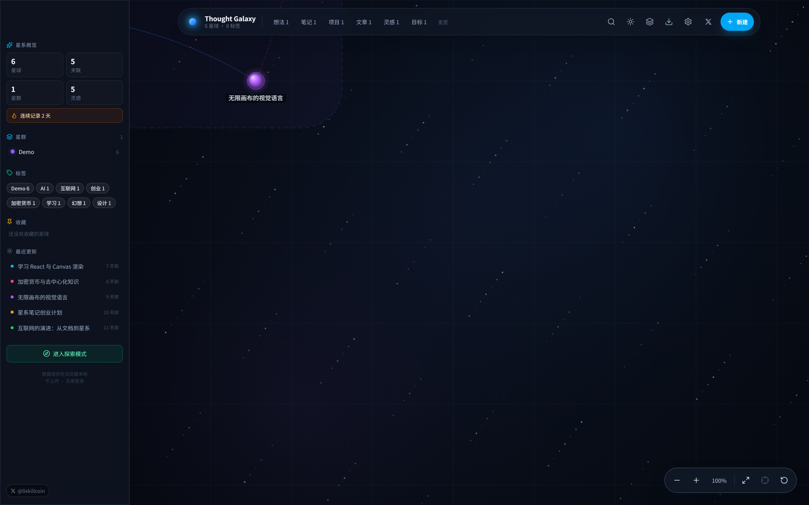

</div>

---

## ✨ What is Thought Galaxy?

**Thought Galaxy** is a spatial, local-first personal knowledge tool. Instead of burying your notes in folders, it turns every idea into a **planet** floating in an infinite, explorable universe.

Every piece of content — an idea, a journal entry, an article, a saved web page, a study note, a project spec — becomes a node in space. Related ideas are connected by **orbits** (edges). Topics that share tags automatically gather into **constellations** (clusters).

> The core belief: *knowledge should not be imprisoned in folders — let it form connections in space.*

### Why it is different

| Typical note app | Thought Galaxy |
| --- | --- |
| Linear list / nested folders | Infinite spatial canvas with real 2D coordinates |
| You remember where you filed it | You remember what it was *near* |
| Links are hidden in metadata | Every relation is drawn, typed and colour-coded |
| Cloud account required | Works offline, no account, no upload |
| AI features you cannot verify | Deterministic clustering you can explain line by line |

---

## 🚀 Features

### The galaxy (home)
- A **real data visualisation**, not a decorative background — every planet is a stored record.
- Deep-space rendering: layered backdrop, twinkling star dust, mouse parallax, planet halos.
- Drag to pan, wheel / pinch to zoom (18% – 400%), fit-all, focus-selected, reset view.
- Auto constellation frames drawn around tag groups.
- **60 fps with 1,200 planets** measured, and 60 fps idle at 3,000 planets (see [Performance](#-performance)).

### Planets (nodes)
8 content types — Idea / Note / Article / Book / Webpage / Project / Goal / Inspiration — each with its own colour.
- Create, edit, delete, favourite (pin), resize, recolour.
- **Markdown** body with a custom, XSS-safe renderer (headings, lists, task lists, quotes, code, links, emphasis).
- Full-text search across title, body, tags and type with deterministic scoring.
- Drag planets to arrange your own mental map — coordinates are persisted.

### Webpage capture
- Paste a URL into the editor; the app tries to fetch `og:title` / `og:description` / `<title>`.
- **If the site blocks cross-origin access, nothing is faked** — you get a clear message and fill the fields manually.

### Relations (edges)
6 relation types, each with its own visual style:

| Relation | Style |
| --- | --- |
| 相关 Related | solid blue |
| 因果 Causal | dashed red |
| 延伸 Extends | long-dash green |
| 对比 Contrast | dotted amber |
| 引用 Reference | solid violet |
| 灵感来源 Inspiration | dashed purple |

Duplicate edges (in either direction) and self-links are rejected at the store layer, not just in the UI.

### Constellations (clusters)
Deterministic, explainable grouping — no paid model, no fake "AI":
1. Any tag shared by **≥ 2 planets** becomes a candidate cluster.
2. Each planet joins its strongest tag's cluster (so it belongs to exactly one).
3. Untagged planets join the cluster they share the most manual edges with.
4. Leftovers form an "Unclassified" group (only when there are 2+).

### Explore mode
Start from any planet and walk outward 1–3 hops along real relations, plus same-constellation siblings, with live counts for direct / second-degree / cluster peers.

### Daily Thought
A separate time track (not planets): one thought per day, streak counter, total count, date-grouped timeline. Deliberately **not** a gamified check-in system.

### Data ownership
- **Export:** full JSON · Markdown bundle (one `.md` per planet + index + links) · complete backup ZIP.
- **Import:** JSON · single or multiple Markdown files · the backup ZIP.
- Import is validated **before** anything is written: duplicate IDs are regenerated, dangling edges rejected, self-links and duplicate edges dropped, and you choose *merge* (default) or *replace*.

### Demo galaxy
First visit seeds a 6-planet demo (AI / Internet / Startup / Design / Crypto / Learning) marked `isDemo: true`. **One click clears the demo and never touches your own records.**

---

## 📸 Screenshots

> All screenshots are real captures of this build, produced by `scripts/capture-screenshots.mjs` — no mockups.

| Planet detail | Editor |
| --- | --- |
| 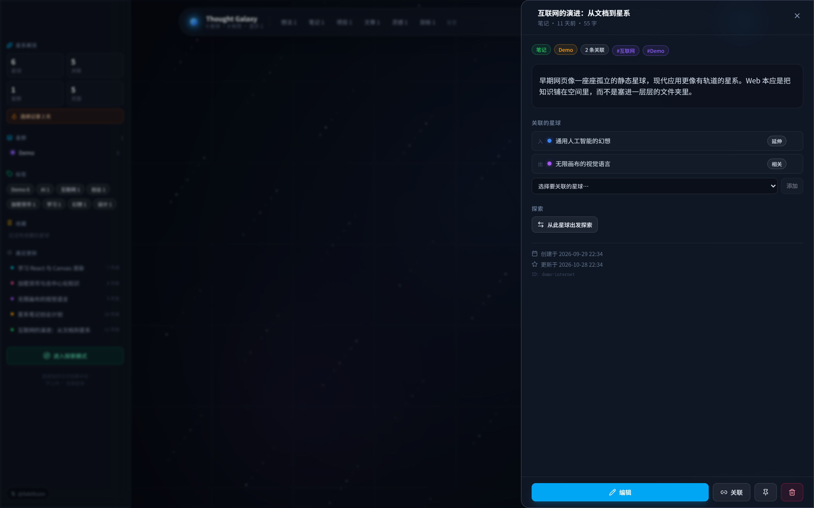 | 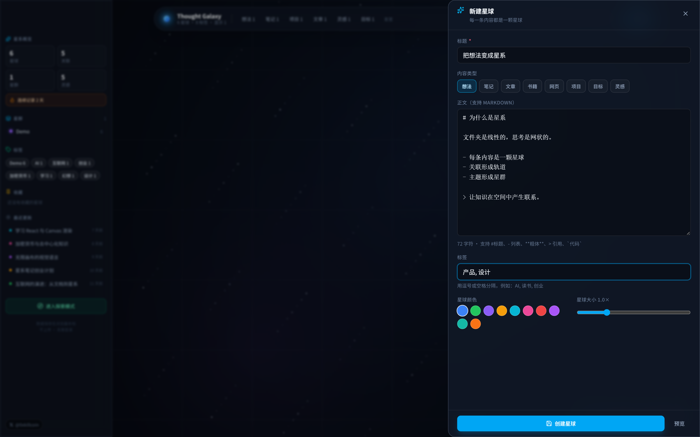 |

| Search & filter | Constellations |
| --- | --- |
| 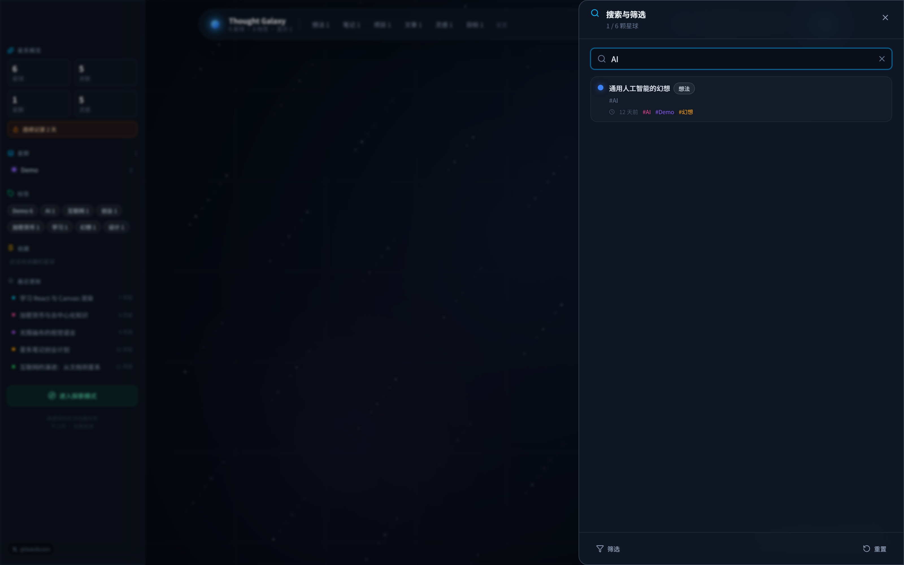 | 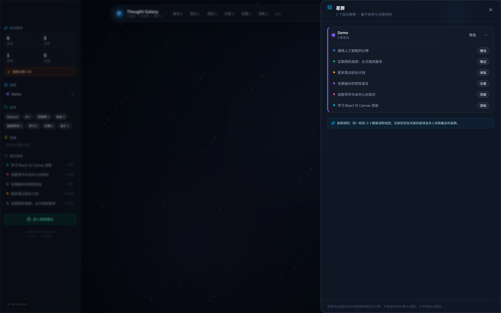 |

| Daily thought | Data import / export |
| --- | --- |
| 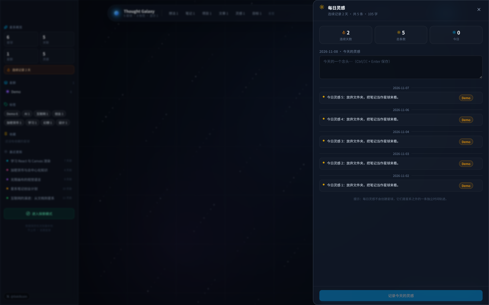 | 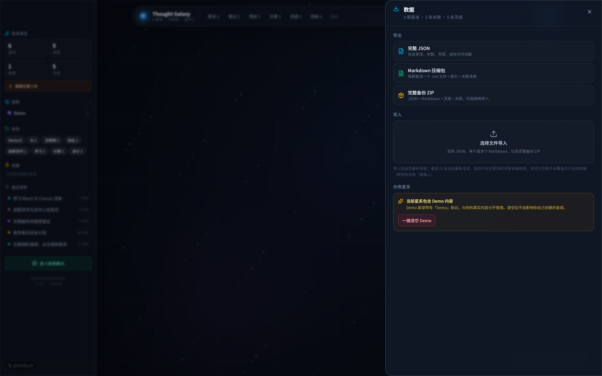 |

| Settings | Command palette (⌘K) |
| --- | --- |
| 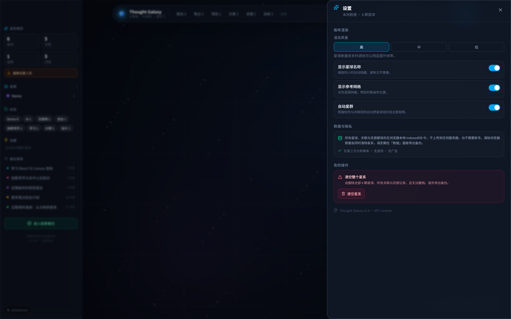 | 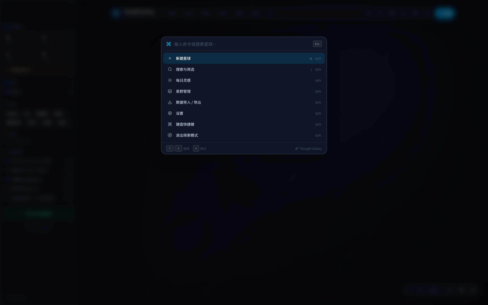 |

### Mobile (iPhone — dedicated layout, not a shrunken desktop)

<p align="center">
  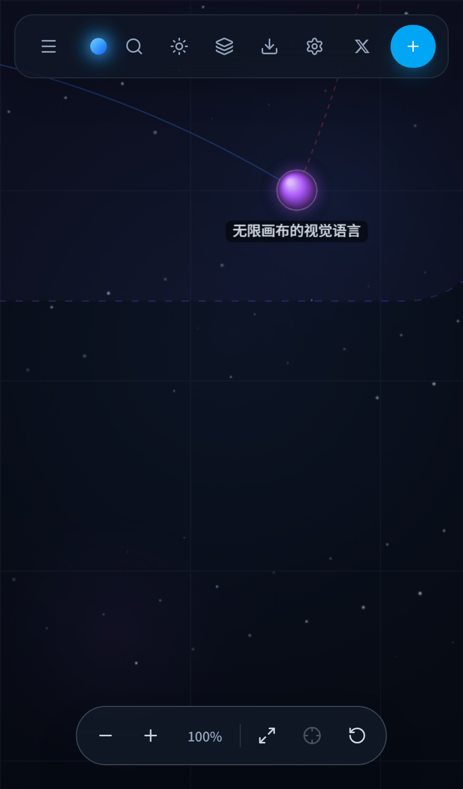
  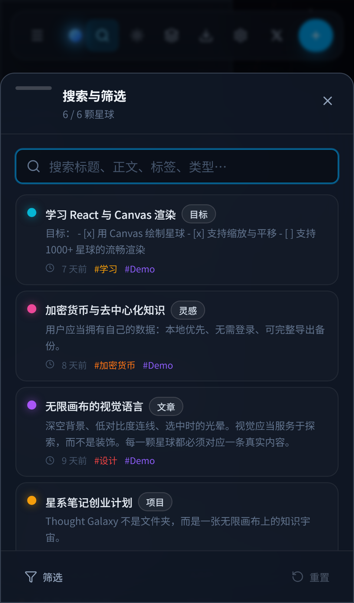
  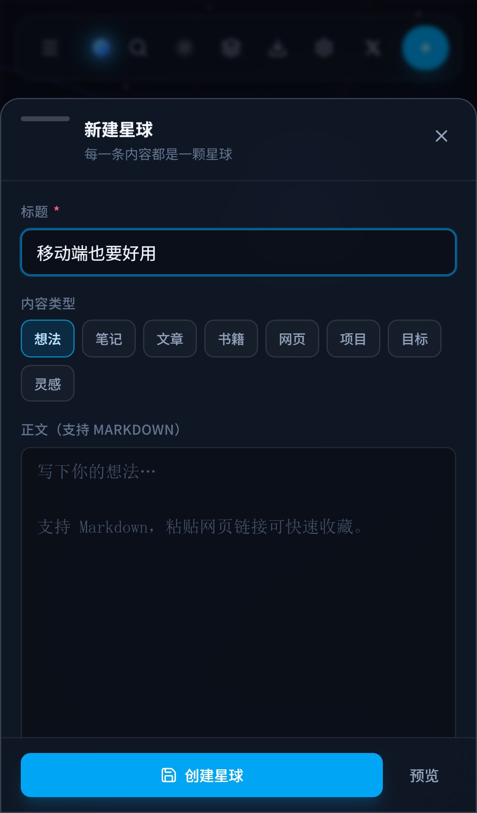
</p>

---

## ⌨️ Keyboard shortcuts

| Key | Action |
| --- | --- |
| `N` | New planet |
| `/` | Search & filter |
| `Ctrl/⌘ + K` | Command palette |
| `F` | Fit all planets |
| `E` | Toggle explore mode |
| `D` | Daily thought |
| `?` | Shortcut help |
| `Esc` | Close panel / cancel linking / deselect |
| Double-click planet | Edit |
| Drag planet | Move it |
| Wheel / pinch | Zoom |

Every single-key shortcut **bails out when the focus is inside an input, textarea, select or contenteditable element**, so typing `n` in a note never opens the editor. `Ctrl/⌘+K` intentionally still works from inputs.

---

## 🏗 Architecture

```
src/
├── components/
│   ├── canvas/
│   │   ├── GalaxyCanvas.tsx   # pointer/touch/keyboard input + render loop
│   │   ├── renderer.ts        # sprite cache, cached layers, static scene, overlay
│   │   ├── viewport.ts        # fit-all / focus / zoom maths
│   │   └── GalaxyHUD.tsx      # zoom + fit controls
│   ├── panels/               # node detail, editor, search, command, clusters,
│   │                         # daily thought, data, settings, shortcuts, explore
│   └── ui/                   # TopBar, SideBar, Sheet, Toast, Markdown, primitives
├── database/
│   ├── db.ts                 # Dexie schema (nodes, edges, thoughts, meta)
│   ├── repository.ts         # atomic read/write, cascade delete, demo purge
│   └── demo.ts               # seeded demo galaxy
├── store/
│   ├── galaxy.ts             # data store (Zustand) + all mutations
│   └── ui.ts                 # viewport, panels, filters, toasts
├── import-export/
│   ├── schema.ts             # validation + coercion + de-duplication
│   ├── markdown.ts           # front-matter round-trip
│   └── io.ts                 # JSON / Markdown / ZIP export & import
├── hooks/                    # bootstrap, derived view, shortcuts
└── utils/                    # types, geometry, colours, clusters, search, format
```

### Rendering strategy (why it stays fast)

1. **Canvas 2D**, not DOM or WebGL — 60 fps with thousands of nodes and no 3D complexity.
2. **Planet sprites** are pre-rendered once per colour into offscreen canvases and blitted with `drawImage`, instead of building a radial gradient per node per frame.
3. **Cached backdrop** (gradient + nebula + star field) is rendered once per size and reused.
4. **Viewport culling** skips anything outside the visible area + margin.
5. **Two-layer compositing**: the expensive static scene (edges, planets, labels) is only redrawn when the view or data actually changes; the per-frame layer draws only light pulses, the selection ring and the link preview.

Measured effect of steps 2–5: **9 fps → 60 fps** at 1,200 planets in headless Chromium.

---

## 📊 Performance

Measured with `node scripts/check-performance.mjs <count>` (headless Chromium, 1600×1000):

| Planets | Edges | Idle FPS | Avg pointer frame |
| --- | --- | --- | --- |
| 1,200 | 599 | **60** | 34 ms |
| 3,000 | 1,499 | **60** | 73 ms |

Quality presets (High / Medium / Low) trade star density, device-pixel-ratio and label budget for speed. Low also disables the faint background edges when zoomed far out.

---

## 🛠 Tech stack

| Layer | Choice |
| --- | --- |
| Framework | React 19 + TypeScript 5.9 |
| Build | Vite 7 |
| Styling | Tailwind CSS 4 (`@theme` tokens) |
| State | Zustand 5 |
| Persistence | Dexie 4 over IndexedDB |
| Canvas | Hand-written Canvas 2D renderer |
| ZIP | fflate |
| Icons | lucide-react |
| Tests | Vitest + fake-indexeddb · Playwright (Desktop Chrome + iPhone 13) |

No backend. No telemetry. No third-party analytics. The whole app is static files.

---

## 🚦 Local development

```bash
git clone https://github.com/iiiiiiiiiiiiiKK/thought-galaxy.git
cd thought-galaxy
npm install
npm run dev          # http://localhost:5183
```

### All scripts

```bash
npm run dev          # dev server
npm run build        # typecheck + production build -> dist/
npm run preview      # serve the production build
npm run typecheck    # tsc --noEmit
npm test             # 38 unit tests (Vitest + fake IndexedDB)
npm run test:e2e     # 12 Playwright E2E specs, desktop + iPhone

# Maintenance / verification helpers (need a running preview server)
npm run screenshots  # regenerate docs/screenshots/**
npm run check:layout # assert no horizontal overflow at 390 / 393 / 320 px
npm run check:perf   # frame-rate benchmark with N synthetic planets
npm run verify:prod  # end-to-end acceptance run against the deployed URL
```

### Optional environment variables

`.env.example` — **no real secrets, ever**:

```dotenv
# Optional: only needed if you deploy under a sub-path (GitHub Pages).
# Defaults to "/" for root deployments (Cloudflare Pages, Vercel, local).
VITE_BASE_PATH=/
```

### Regenerating the README screenshots

```bash
npm run build && npm run preview -- --port 5184
node scripts/capture-screenshots.mjs http://127.0.0.1:5184/
```

---

## ✅ Test results (real, from this repository)

```
npm test
 ✓ tests/unit/galaxy-utils.test.ts  (21 tests)
 ✓ tests/unit/schema.test.ts        (13 tests)
 ✓ tests/unit/repository.test.ts    ( 4 tests)
 Test Files  3 passed (3)
      Tests  38 passed (38)

npm run test:e2e              # --project=desktop
 12 passed  (core: 7, interaction: 5)

npm run test:e2e              # --project=iphone
 7 passed

npm run verify:prod           # against the live GitHub Pages URL
 10/10 acceptance checks passed, 0 console errors
```

Production acceptance output (trimmed):

```json
{
  "url": "https://iiiiiiiiiiiiiKK.github.io/thought-galaxy/",
  "results": [
    { "check": "canvas rendered", "ok": true },
    { "check": "X author link", "ok": true },
    { "check": "demo galaxy seeded", "ok": true },
    { "check": "create planet", "ok": true },
    { "check": "detail shows title", "ok": true },
    { "check": "persisted after reload", "ok": true },
    { "check": "tags persisted", "ok": true },
    { "check": "export JSON download", "ok": true, "detail": "thought-galaxy-20261108.json" },
    { "check": "mobile: no horizontal overflow", "ok": true, "detail": "390<=390" },
    { "check": "mobile: search sheet opens", "ok": true }
  ],
  "consoleErrors": []
}
```

Coverage of the required checklist:

| # | Requirement | Verified by |
| --- | --- | --- |
| 1 | Create planet | `core.spec: creates a node…`, `node-editor` |
| 2 | Edit planet | unit + editor panel round-trip |
| 3 | Delete planet | cascade delete unit test + detail panel |
| 4 | Create relation | `interaction.spec: creates then deletes a relation` |
| 5 | Delete relation | same spec (delete half) |
| 6 | Drag planet | canvas pointer handler + persisted `x/y` |
| 7 | Zoom canvas | `interaction.spec: wheel zooms…` (HUD % assertion) |
| 8 | Search → locate | `core.spec: search filters the galaxy` |
| 9 | Tag filter | `interaction.spec: tag filtering narrows…` |
| 10 | Import | `interaction.spec: imports a JSON file…` |
| 11 | Export | `core.spec: exports a JSON backup` (real download event) |
| 12 | Refresh persistence | `core.spec: …persists it after reload` |
| 13 | Demo cleanup | `core.spec: clears the demo galaxy without touching user data` |
| 14 | Mobile interaction | iPhone project (7 specs) + layout overflow check at 390/393/320 px |
| 15 | Many nodes | `scripts/check-performance.mjs` (1,200 & 3,000 planets) |

Error paths that are implemented **and** exercised: empty galaxy (welcome overlay), corrupted/unparsable import file (visible error, nothing written), duplicate IDs (regenerated), dangling self/duplicate edges (rejected), IndexedDB unavailable (persistent warning banner + app still runs in memory).

---

## 🔐 Privacy & data storage

- **Everything lives in your browser's IndexedDB** under the database name `thought-galaxy`.
- No account, no server, no sync, no upload. `localStorage` stores exactly one flag (has the welcome overlay been dismissed).
- The only network request the app can make is the **optional** `og:` metadata fetch when *you* paste a URL into the webpage editor. If it fails, you are told so.
- Clearing browser data clears your galaxy — **export a backup first** (Data panel → full backup ZIP).

---

## 🌍 Deployment

### GitHub Pages (used for the live demo)

`.github/workflows/deploy-pages.yml` builds with `VITE_BASE_PATH=/<repo>/`, runs typecheck + unit tests, copies `index.html` → `404.html` for SPA routing, and publishes to Pages.

Manual variant:

```bash
VITE_BASE_PATH=/thought-galaxy/ npm run build
# publish dist/ to the gh-pages branch or your Pages source
```

### Cloudflare Pages / Vercel

Static site, no functions required:

| Setting | Value |
| --- | --- |
| Framework preset | Vite |
| Build command | `npm run build` |
| Output directory | `dist` |
| Node version | 20.19+ (22 recommended) |
| Env var | `VITE_BASE_PATH=/` (root deploy) |

---

## 🧭 Known limitations

Honest list — nothing here is disguised as "done":

1. **No cloud sync.** Local-first by design; cross-device sync is a future phase and would be opt-in.
2. **Automatic webpage metadata can fail** on sites without CORS headers. This is a browser security boundary; the app asks you to fill the fields instead of inventing them.
3. **Clustering is rule-based** (tags + manual edges). There is no semantic/NLP model, and the app never pretends to have one.
4. **Import from ZIP** expects the structure this app exports (a `thought-galaxy.json`, or Markdown files). Arbitrary third-party ZIPs are not mapped.
5. **Favourite filter is a simple pin flag** — there is no separate "star rating" or multi-collection system.
6. **Mobile has no long-press context menu**; actions live in the bottom sheet.
7. **Single-user, single-browser profile.** Two tabs write to the same IndexedDB; there is no conflict resolution beyond last-write-wins per record.
8. **No undo stack** for deletions (the delete confirmation is the safeguard).

---

## 🗺 Roadmap

- [ ] Optional end-to-end encrypted sync (explicitly opt-in)
- [ ] Long-press context menu on mobile
- [ ] Undo history for destructive actions
- [ ] Bulk selection and batch tagging on the canvas
- [ ] Import mapping for Obsidian / Notion exports

---

## 🤝 Contributing

Issues and PRs are welcome.

```bash
npm install
npm run typecheck && npm test && npm run build
```

Please keep the two invariants of this project:
1. **Never fabricate data or capability.** If a feature is not implemented, it must say so.
2. **Keys never enter the repo.** Use `.env.local` (git-ignored).

---

## 📄 License

[MIT](./LICENSE) — dependencies are all MIT/Apache-2.0/ISC compatible (React, Vite, Dexie, Zustand, fflate, lucide-react, Tailwind).

---

<div align="center">

**Built by [@0xkillcoin](https://x.com/0xkillcoin)**

*Stop filing your thoughts. Start exploring them.*

</div>
