<div align="center">

# 🌌 思维星系 · Thought Galaxy

**每一个想法，都有自己的宇宙。**
*Your Thoughts Have a Universe.*

[](https://iiiiiiiiiiiiiKK.github.io/thought-galaxy/)
[](./LICENSE)
[](https://react.dev)
[](https://www.typescriptlang.org)
[]()
[](https://x.com/0xkillcoin)

[English](./README.md) · [简体中文](#-思维星系是什么)

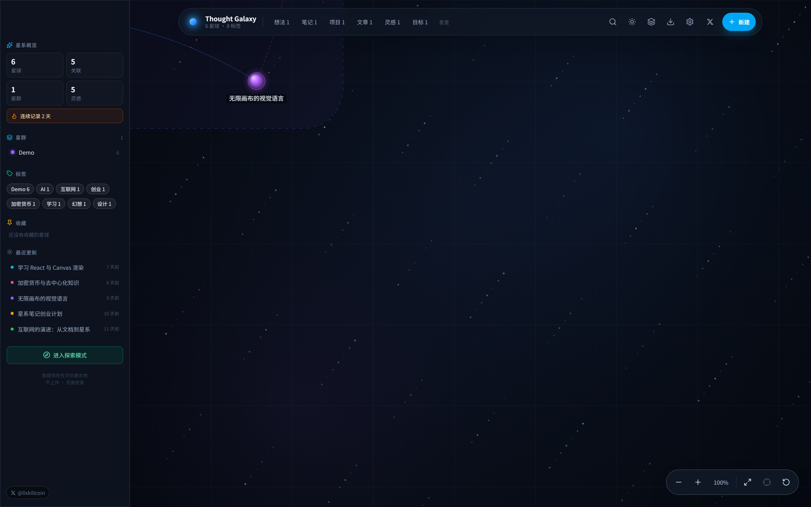

</div>

---

## ✨ 思维星系是什么？

**Thought Galaxy（思维星系）** 是一个空间化的个人知识管理工具，采用本地优先（local-first）架构。

它不把你的笔记放进文件夹，而是把**每一条内容变成一颗星球**，漂浮在一张可以自由缩放、拖动、探索的无限画布上。

灵感、日记、笔记、文章、网页收藏、学习记录、项目资料 —— 都可以成为星系里的一个节点。相关的内容之间形成**轨道**（关联），同一主题的内容自动聚成**星群**。

> 核心理念：**不要让知识被困在文件夹里，让它们在空间中产生联系。**

### 它与普通笔记软件的区别

| 普通笔记软件 | 思维星系 |
| --- | --- |
| 线性列表 / 多层文件夹 | 无限二维画布，位置真实持久 |
| 你要记住把它存在哪 | 你只要记住它「在谁旁边」 |
| 关联藏在元数据里 | 每条关系都画出来，有类型、有样式 |
| 需要注册账号、上传云端 | 完全离线，无账号，不上传 |
| 无法验证的「AI 智能分类」 | 可以逐条解释的确定性规则聚类 |

---

## 🚀 功能

### 星系首页
- **真实的数据可视化**，不是装饰性背景 —— 每颗星球都对应一条真实存储的记录。
- 深空视觉：分层背景、闪烁星尘、鼠标视差、星球光晕。
- 拖动平移，滚轮 / 双指缩放（18% – 400%），适配全部、定位选中、重置视角。
- 按标签自动绘制星群边框。
- **1,200 颗星球实测 60fps**，3,000 颗星球静止状态同样 60fps（见[性能](#-性能)）。

### 星球（节点）
8 种内容类型：想法 / 笔记 / 文章 / 书籍 / 网页 / 项目 / 目标 / 灵感，各有专属配色。
- 创建、编辑、删除、收藏、调整大小、修改颜色。
- **Markdown** 正文，自研安全渲染器（标题、列表、任务列表、引用、代码、链接、强调），**结构上不可能 XSS**。
- 全文搜索覆盖标题、正文、标签、类型，评分规则完全确定。
- 拖动星球整理属于你自己的心智地图，坐标会被持久化。

### 网页收藏
- 在编辑器里粘贴 URL，应用会尝试抓取 `og:title` / `og:description` / `<title>`。
- **如果目标站点禁止跨域访问，绝不伪造信息** —— 明确提示失败，由你手动填写。

### 关联（轨道）
6 种关系类型，各有独立视觉样式：

| 关系 | 样式 |
| --- | --- |
| 相关 | 蓝色实线 |
| 因果 | 红色虚线 |
| 延伸 | 绿色长虚线 |
| 对比 | 琥珀色点线 |
| 引用 | 紫色实线 |
| 灵感来源 | 紫色虚线 |

重复关联（任一方向）与自关联在**数据层**被拒绝，不只是界面拦截。

### 星群
完全确定、可解释的分组规则 —— 不接付费模型，不假装有语义分析：
1. 任意被 **≥ 2 颗星球**共享的标签成为候选星群。
2. 每颗星球只加入它「最强标签」对应的星群（保证一颗只属于一个）。
3. 无标签但有关联的星球，并入与它关联最多的星群。
4. 剩下 2 颗以上时，形成「未分类」。

### 探索模式
从任意星球出发，沿真实关联向外走 1–3 层，并纳入同星群成员，实时显示直接关联 / 二级关联 / 同星群的数量。

### 每日灵感
一条独立于星球的**时间轨迹**：每天一条、连续天数、总条数、按日期分组的时间轴。刻意不做成复杂的打卡系统。

### 数据主权
- **导出**：完整 JSON · Markdown 压缩包（每颗星球一个 `.md` + 索引 + 关联清单）· 完整备份 ZIP。
- **导入**：JSON · 单个或多个 Markdown · 备份 ZIP。
- 导入**先校验后写入**：重复 ID 自动重新生成，指向不存在星球的关联被拒绝，自关联与重复关联被丢弃；可选「合并」（默认）或「替换」。

### 示例星系
首次进入会生成 6 颗 Demo 星球（AI / 互联网 / 创业 / 设计 / 加密货币 / 学习），全部标记 `isDemo: true`。**一键清空 Demo，绝不会碰你自己的记录。**

---

## 📸 界面截图

> 全部截图都是本项目真实运行画面，由 `scripts/capture-screenshots.mjs` 自动生成，没有使用任何占位图或效果图。

| 星球详情 | 编辑器 |
| --- | --- |
| 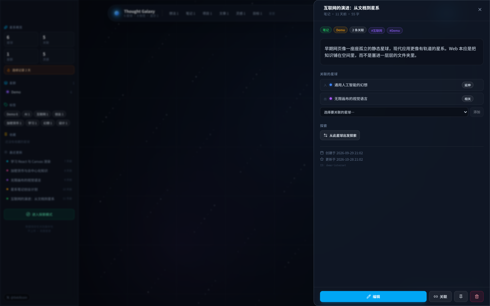 | 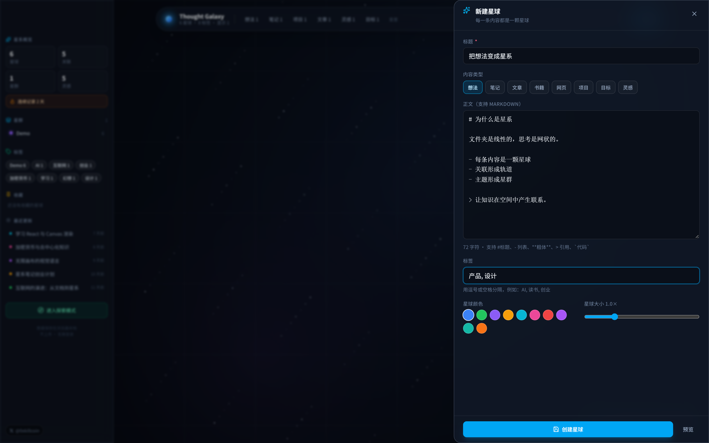 |

| 搜索与筛选 | 星群 |
| --- | --- |
| 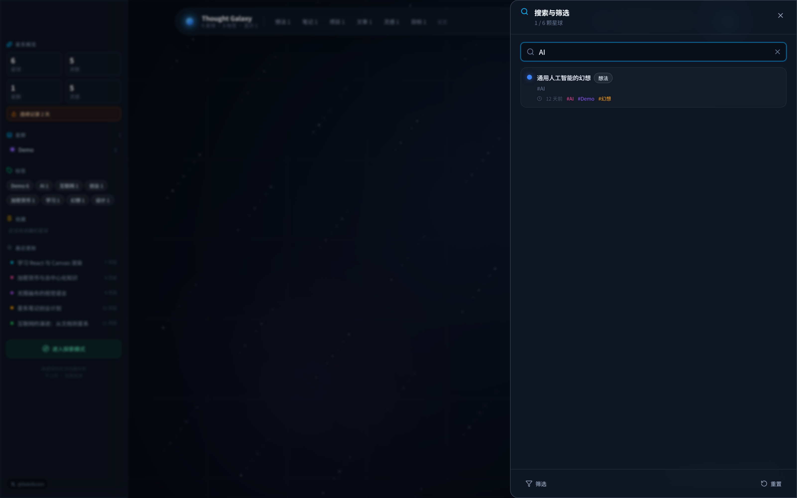 | 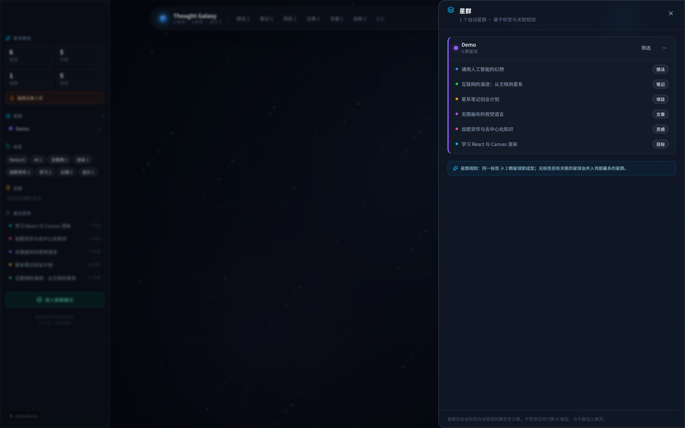 |

| 每日灵感 | 数据导入导出 |
| --- | --- |
| 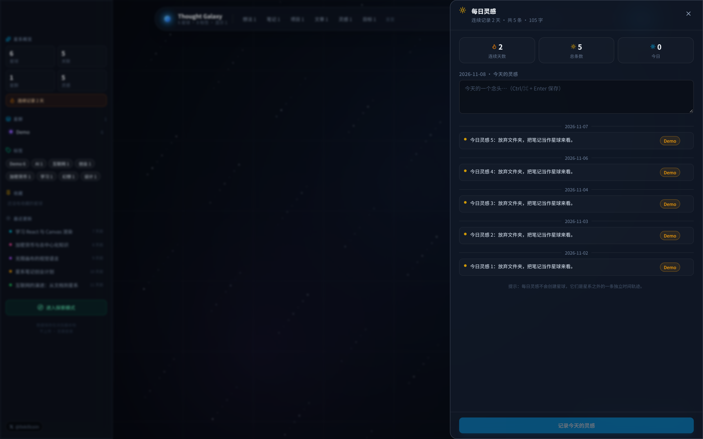 | 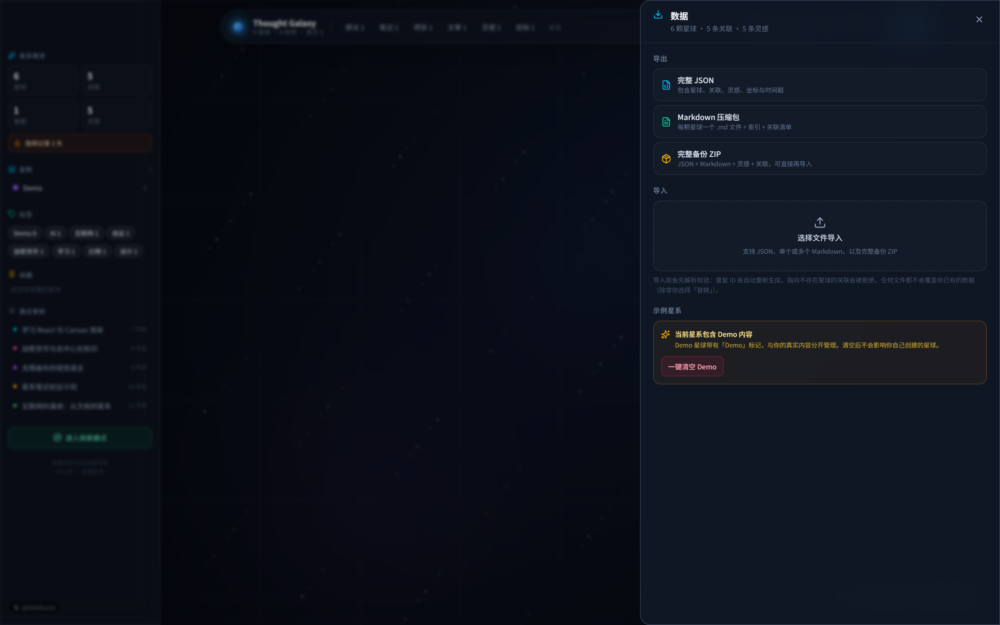 |

| 设置 | 命令面板（⌘K） |
| --- | --- |
| 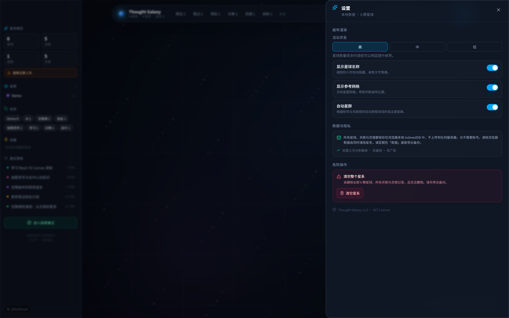 | 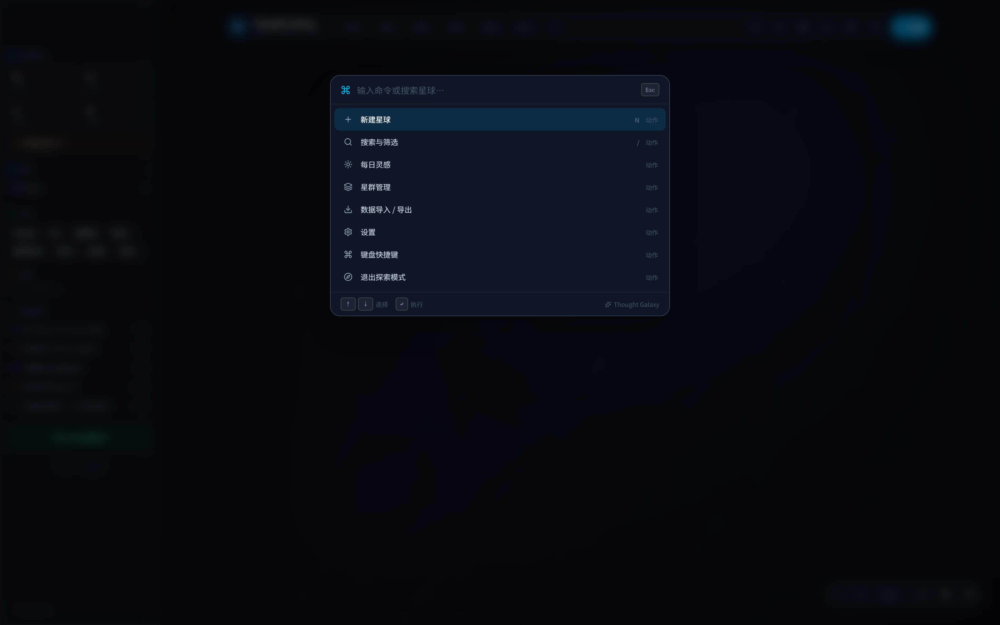 |

### 移动端（iPhone 专属布局，不是把桌面缩小）

<p align="center">
  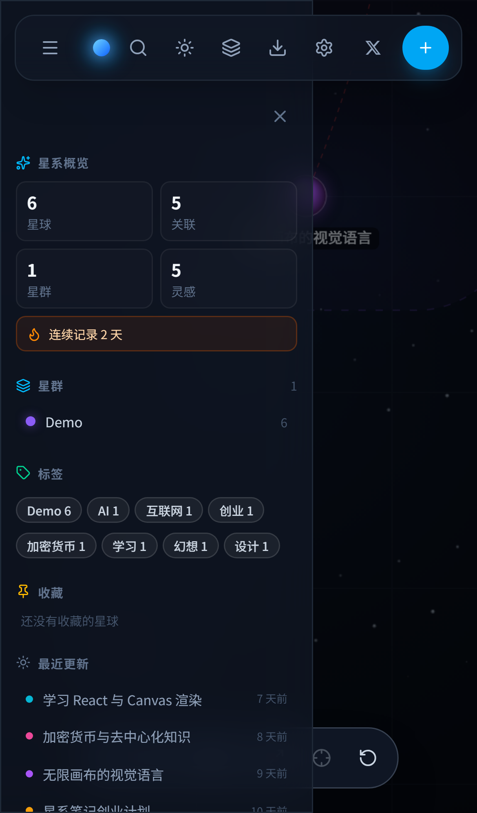
  
  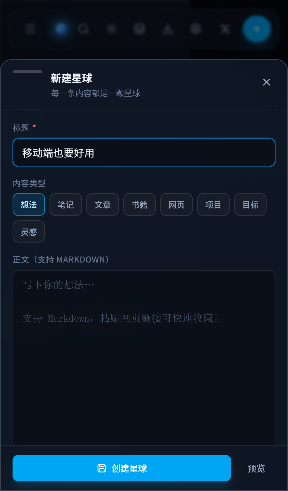
</p>

---

## ⌨️ 快捷键

| 按键 | 作用 |
| --- | --- |
| `N` | 新建星球 |
| `/` | 搜索与筛选 |
| `Ctrl/⌘ + K` | 命令面板 |
| `F` | 适配全部星球 |
| `E` | 切换探索模式 |
| `D` | 每日灵感 |
| `?` | 快捷键帮助 |
| `Esc` | 关闭面板 / 取消关联 / 取消选中 |
| 双击星球 | 进入编辑 |
| 拖动星球 | 改变位置 |
| 滚轮 / 双指 | 缩放 |

所有单键快捷键在焦点位于输入框、文本域、下拉框或可编辑区域时**自动失效**，因此在笔记里输入 `n` 不会弹出新建面板；`Ctrl/⌘+K` 例外，在输入框中依然可用。

---

## 🏗 技术架构

```
src/
├── components/
│   ├── canvas/
│   │   ├── GalaxyCanvas.tsx   # 指针/触摸/键盘交互 + 渲染循环
│   │   ├── renderer.ts        # 精灵缓存、图层缓存、静态场景、动态覆盖层
│   │   ├── viewport.ts        # 适配全部 / 定位 / 缩放数学
│   │   └── GalaxyHUD.tsx      # 缩放与适配控件
│   ├── panels/               # 详情、编辑器、搜索、命令面板、星群、
│   │                         # 每日灵感、数据、设置、快捷键、探索
│   └── ui/                   # TopBar、SideBar、Sheet、Toast、Markdown、基础组件
├── database/
│   ├── db.ts                 # Dexie 表结构（nodes / edges / thoughts / meta）
│   ├── repository.ts         # 原子读写、级联删除、Demo 清理
│   └── demo.ts               # 示例星系数据
├── store/
│   ├── galaxy.ts             # 数据状态（Zustand）+ 全部写操作
│   └── ui.ts                 # 视口、面板、筛选、提示
├── import-export/
│   ├── schema.ts             # 校验 + 类型纠正 + 去重
│   ├── markdown.ts           # front-matter 双向转换
│   └── io.ts                 # JSON / Markdown / ZIP 导入导出
├── hooks/                    # 启动引导、派生视图、快捷键
└── utils/                    # 类型、几何、颜色、聚类、搜索、格式化
```

### 渲染策略（为什么这么快）

1. **Canvas 2D**，不用 DOM、不用 WebGL —— 上千节点也能 60fps，且没有 3D 复杂度。
2. **星球精灵预渲染**：每种颜色只渲染一次到离屏 canvas，之后 `drawImage` 直接贴图，避免「每节点每帧重建径向渐变」这一最大开销。
3. **背景图层缓存**：渐变 + 星云 + 星场按尺寸缓存，每帧只做两次贴图。
4. **视口裁剪**：视野 + 边距之外的内容完全跳过。
5. **双层合成**：昂贵的静态场景（连线、星球、标签）只在视图或数据真正变化时重绘；每帧层只画光点脉冲、选中光环与连线预览。

实测：第 2–5 项优化把 1,200 颗星球的无头 Chromium 帧率从 **9fps 提升到 60fps**。

---

## 📊 性能

用 `node scripts/check-performance.mjs <数量>` 实测（无头 Chromium，1600×1000）：

| 星球数 | 关联数 | 静止 FPS | 指针平均帧耗时 |
| --- | --- | --- | --- |
| 1,200 | 599 | **60** | 34 ms |
| 3,000 | 1,499 | **60** | 73 ms |

渲染质量分「高 / 中 / 低」，分别调整星星密度、设备像素比与标签预算；低质量在极度缩小时还会隐藏淡色背景连线。

---

## 🛠 技术栈

| 层次 | 选择 |
| --- | --- |
| 框架 | React 19 + TypeScript 5.9 |
| 构建 | Vite 7 |
| 样式 | Tailwind CSS 4（`@theme` 变量） |
| 状态 | Zustand 5 |
| 持久化 | Dexie 4 / IndexedDB |
| 画布 | 自研 Canvas 2D 渲染器 |
| 压缩 | fflate |
| 图标 | lucide-react |
| 测试 | Vitest + fake-indexeddb · Playwright（桌面 Chrome + iPhone 13） |

**没有后端**，没有埋点，没有第三方统计，整个应用就是一组静态文件。

---

## 🚦 本地运行

```bash
git clone https://github.com/iiiiiiiiiiiiiKK/thought-galaxy.git
cd thought-galaxy
npm install
npm run dev          # http://localhost:5183
```

### 全部命令

```bash
npm run dev         # 开发服务器
npm run build       # 类型检查 + 生产构建 -> dist/
npm run preview     # 预览生产构建
npm run typecheck   # tsc --noEmit
npm test            # 38 个单元测试（Vitest + 假 IndexedDB）
npm run test:e2e    # 12 个 Playwright E2E，覆盖桌面与 iPhone
```

### 可选环境变量

`.env.example` —— **永远不包含真实密钥**：

```dotenv
# 可选：只有在子路径部署时才需要（例如 GitHub Pages）。
# 根路径部署（Cloudflare Pages / Vercel / 本地）保持默认 "/"。
VITE_BASE_PATH=/
```

### 重新生成 README 截图

```bash
npm run build && npm run preview -- --port 5184
node scripts/capture-screenshots.mjs http://127.0.0.1:5184/
```

---

## ✅ 测试结果（本项目真实输出）

```
npm test
 ✓ tests/unit/galaxy-utils.test.ts  (21 个测试)
 ✓ tests/unit/schema.test.ts        (13 个测试)
 ✓ tests/unit/repository.test.ts    ( 4 个测试)
 Test Files  3 passed (3)
      Tests  38 passed (38)

npm run test:e2e              # --project=desktop
 12 passed  （core 7 个，interaction 5 个）

npm run test:e2e              # --project=iphone
 7 passed
```

需求清单逐项验证：

| # | 要求 | 验证方式 |
| --- | --- | --- |
| 1 | 创建星球 | `core.spec: creates a node…` + 编辑器 |
| 2 | 编辑星球 | 单元测试 + 编辑器往返 |
| 3 | 删除星球 | 级联删除单元测试 + 详情面板 |
| 4 | 创建关联 | `interaction.spec: creates then deletes a relation` |
| 5 | 删除关联 | 同一用例的后半段 |
| 6 | 拖动星球 | 画布指针处理 + `x/y` 持久化 |
| 7 | 画布缩放 | `interaction.spec: wheel zooms…`（断言 HUD 百分比） |
| 8 | 搜索定位 | `core.spec: search filters the galaxy` |
| 9 | 标签筛选 | `interaction.spec: tag filtering narrows…` |
| 10 | 数据导入 | `interaction.spec: imports a JSON file…` |
| 11 | 数据导出 | `core.spec: exports a JSON backup`（真实 download 事件） |
| 12 | 刷新后持久化 | `core.spec: …persists it after reload` |
| 13 | Demo 清理 | `core.spec: clears the demo galaxy without touching user data` |
| 14 | 移动端交互 | iPhone 项目 7 个用例 + 390/393/320px 溢出检测 |
| 15 | 大量节点性能 | `scripts/check-performance.mjs`（1,200 与 3,000 颗） |

已实现且被测试覆盖的异常路径：空星系（欢迎引导）、损坏的导入文件（明确报错且不写入）、重复 ID（重新生成）、自关联/重复/悬空关联（拒绝）、IndexedDB 不可用（常驻警告条，应用仍可在内存内运行）。

---

## 🔐 隐私与数据存储

- **所有数据都保存在浏览器的 IndexedDB** 中，数据库名 `thought-galaxy`。
- 没有账号、没有服务器、没有同步、没有上传。`localStorage` 只存一个标记（欢迎引导是否已关闭）。
- 应用唯一可能发起的网络请求，是**你自己**在网页编辑器里粘贴链接后可选触发的 `og:` 元数据抓取；失败会明确告知。
- 清除浏览器数据会清除星系 —— **请先导出备份**（数据面板 → 完整备份 ZIP）。

---

## 🌍 部署

### GitHub Pages（当前在线演示使用）

`.github/workflows/deploy-pages.yml` 会以 `VITE_BASE_PATH=/<仓库名>/` 构建，先跑类型检查与单元测试，把 `index.html` 复制为 `404.html` 以支持 SPA 路由，再发布到 Pages。

手动方式：

```bash
VITE_BASE_PATH=/thought-galaxy/ npm run build
# 将 dist/ 发布到 gh-pages 分支或 Pages 源
```

### Cloudflare Pages / Vercel

纯静态站点，不需要任何函数：

| 配置项 | 值 |
| --- | --- |
| 框架预设 | Vite |
| 构建命令 | `npm run build` |
| 输出目录 | `dist` |
| Node 版本 | 20.19+（推荐 22） |
| 环境变量 | `VITE_BASE_PATH=/`（根路径部署） |

---

## 🧭 已知限制

诚实清单 —— 没有任何一条被伪装成「已完成」：

1. **没有云同步。** 本地优先是设计选择；跨设备同步属于后续阶段，并且会做成明确可选。
2. **网页元数据可能抓取失败。** 这是浏览器跨域安全边界，应用会请你手动填写，而不是编造内容。
3. **聚类是规则驱动**（标签 + 手动关联），没有语义/NLP 模型，应用也从不假装具备。
4. **ZIP 导入**期望本应用导出的结构（`thought-galaxy.json` 或 Markdown 文件），不会映射任意第三方 ZIP。
5. **收藏是单一的置顶标记**，没有额外的星级或多收藏夹体系。
6. **移动端没有长按菜单**，所有操作都在底部面板中。
7. **单用户、单浏览器配置。** 多个标签页写同一个 IndexedDB，冲突解决仅为「按记录后写覆盖」，没有更复杂的合并。
8. **删除没有撤销栈**，安全措施是删除前的二次确认。

---

## 🗺 后续计划

- [ ] 可选的端到端加密同步（明确 opt-in）
- [ ] 移动端长按菜单
- [ ] 破坏性操作撤销历史
- [ ] 画布框选与批量打标签
- [ ] Obsidian / Notion 导出映射

---

## 🤝 参与贡献

欢迎提交 Issue 与 PR。

```bash
npm install
npm run typecheck && npm test && npm run build
```

请守住这个项目的两条底线：
1. **绝不伪造数据或能力。** 没实现的功能必须如实说明。
2. **绝不把密钥提交进仓库。** 本地用 `.env.local`（已被 git 忽略）。

---

## 📄 开源许可证

[MIT](./LICENSE) —— 依赖均为 MIT / Apache-2.0 / ISC 兼容许可（React、Vite、Dexie、Zustand、fflate、lucide-react、Tailwind）。

---

<div align="center">

**作者 [@0xkillcoin](https://x.com/0xkillcoin)**

*别再归置你的想法，开始探索它们。*

</div>
